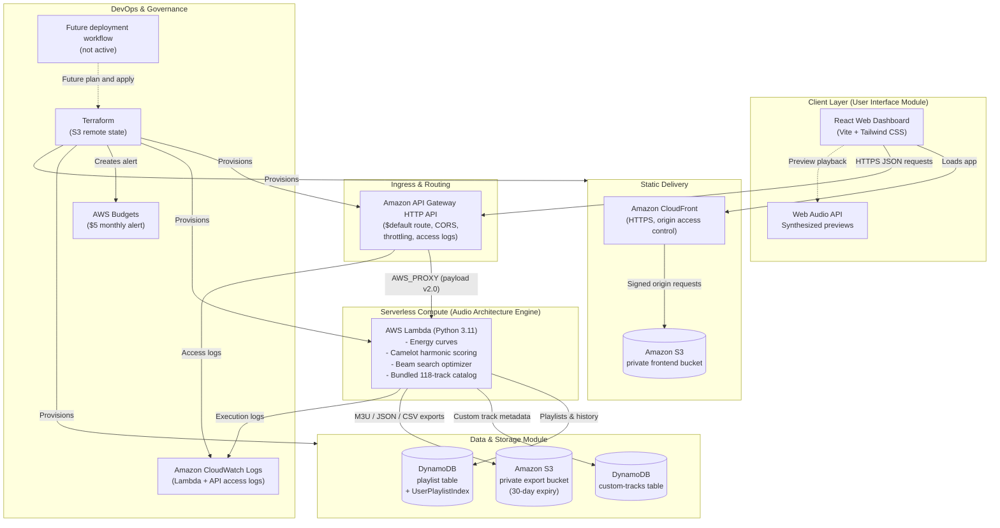
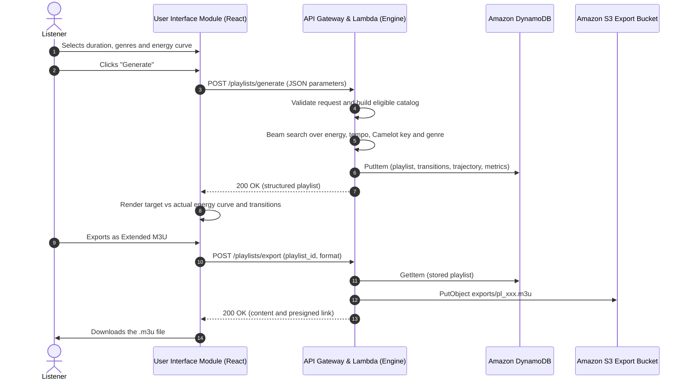

# Technical Design Document: Audio Architecture & Playlist Structuring API

Repository: https://github.com/VaibhavBhatia-0/Audio-Architecture-Playlist-Structuring-API

---

## 1. Introduction

Continuous audio listening is an integral component of modern cognitive environments, ranging from high-focus work and study sessions to interval athletic conditioning and mindful decompression. While modern streaming platforms provide millions of tracks, automated recommendation systems typically rely on collaborative filtering or track-by-track shuffle heuristics that prioritize individual track affinity rather than macro-level temporal energy progression.

The **Audio Architecture & Playlist Structuring API** has a browser-only demo, a local Python API, and a future serverless AWS deployment template. By treating playlist sequencing as a multi-objective trajectory optimization problem over acoustic feature spaces (energy, tempo/BPM, Camelot harmonic key, and acoustic affinity), the system targets deliberate energy flow across extended sessions without the cognitive burden of manual curation.

---

## 2. Problem Statement

Listeners face several systemic barriers when attempting to curate functional, extended audio sessions:
1. **Jarring Energy Inconsistencies & Attention Fragmentation:** Unplanned fluctuations in acoustic energy break listener immersion and concentration during deep work or workout regimens.
2. **Cohesion Breakdown Across Disparate Genres:** Blending diverse genres—such as *Contemporary Classical Piano*, *Indie Pop*, and *Hip-Hop*—frequently results in dissonant musical key clashes and abrupt tempo discrepancies when automated tools are utilized.
3. **Absence of Real-Time Curve Shaping:** Existing algorithmic curation tools lack the capacity for users to prescribe continuous mathematical profiles (such as Pomodoro focus arcs, interval waves, or continuous ascents) that dynamically map to session duration.
4. **Cognitive Overhead of Manual Curation:** Manually selecting, checking musical keys, and sequencing 20 to 50 tracks for a 90-minute session demands disproportionate time and specialized DJ/harmonic mixing knowledge.

---

## 3. Solution Architecture

The current hosted configuration is a static React browser demo; without an
API URL, it uses browser storage and a simpler browser optimizer. The full
Python beam-search API runs locally. The diagram below describes a *future*
AWS architecture defined in `terraform/`, not deployed resources. GitHub Actions
currently runs checks only; no AWS deployment workflow is active. See
`DEPLOYMENT.md` for the current status.



### Proposed AWS Managed Services (not deployed)
1. **AWS Lambda:** Runs the sequencing engine. The track catalog is packaged
   with the function and loaded once per execution environment. Memory 256 MB,
   timeout 30 s.
2. **Amazon API Gateway (HTTP API):** Single `$default` route to Lambda, CORS
   handling, CloudWatch access logs and stage-wide throttling (default 5
   requests/second, burst 10; excess requests receive `429`).
3. **Amazon DynamoDB:** Two on-demand tables. The playlist table stores
   generated playlists and serves history through `UserPlaylistIndex`; the
   custom-tracks table stores user-added track metadata.
4. **Amazon S3:** A private export bucket for M3U, JSON and CSV files, returned
   to the browser as one-hour presigned links and expired after 30 days, and a
   private bucket holding the compiled React application.
5. **Amazon CloudFront:** HTTPS delivery of the React application from the
   private frontend bucket through origin access control.
6. **Amazon CloudWatch and AWS Budgets:** Lambda and API Gateway logs (14-day
   retention) and a $5.00 monthly budget with 80%, 100% and forecast alerts.
   Budget alerts notify the account owner; they do not cap spending.

Tooling: Terraform (future infrastructure template) and GitHub Actions (CI checks).

---

## 4. Application Architecture

The system consists of four modules:

| Module | Implementation |
| :--- | :--- |
| User Interface | React dashboard (`frontend/src/`): duration, genres, preset or custom energy curve, BPM bounds, exclusions, crossfade, scenario starters, custom-track form, history and export dialogs. Results (metrics, energy chart, tracklist) appear directly below the builder. |
| Audio Architecture Engine (API) | Lambda handler (`backend/app/lambda_handler.py`) with request validation and the engine in `backend/app/engine/`. |
| Data & Storage | `backend/app/storage/`: DynamoDB adapters for playlists and custom tracks, with a local-disk adapter for development. In AWS, storage failures return `503` instead of silently using temporary Lambda disk. |
| Export & Integration | `backend/app/export/exporters.py`: Extended M3U, JSON and CSV, stored in S3 and returned to the browser. |



The export endpoint reads the playlist from storage by ID and ignores any
playlist body sent by the client, so a caller cannot overwrite another
playlist's export file with arbitrary content.

If the API is unreachable, the browser switches to a clearly labeled offline
mode that uses a simpler greedy optimizer and browser storage.

### Interface design

The dashboard uses a light, print-like "cue sheet" style instead of a dark
dashboard: a warm paper background, ink text, a single vermillion accent and
earthy genre colours. Headings use the Fraunces serif, body text Instrument
Sans and figures JetBrains Mono. Ruled lines separate sections instead of
cards, and all colours are solid design tokens in `frontend/src/index.css`.
The builder presents four lettered steps (energy shape, genres, length, fine
tuning) next to a sticky summary that holds the Generate button. Focus is
always visible, chart points are keyboard-operable, dialogs trap focus, and
motion respects reduced-motion settings. At 375 px width the page has no
horizontal scrolling; the chart and tracklist scroll inside their own areas.

---

## 5. Technical Designs

`docs/MATHEMATICAL_FORMULATION.md` gives the complete scoring definitions.
This section summarizes them.

### 5.1 Mathematical Energy Profiling Formulation

The target energy profile is a function
$$E_{\text{target}}(t): [0, 1] \rightarrow [0.05, 0.95]$$
where $t = \frac{\tau}{D}$ is normalized session time, $\tau$ is elapsed
seconds and $D$ is the session duration.

#### Implemented Curve Equations
1. **Pomodoro Focus Peak:**
   $$E_{\text{pomodoro}}(t) = \begin{cases}
   0.25 + 0.47 \left(\frac{t}{0.20}\right)^{1.3} & t < 0.20 \quad \text{(Warm-up)} \\
   0.72 + 0.12 \sin\left(\frac{t - 0.20}{0.60} \cdot \pi\right) & 0.20 \le t \le 0.80 \quad \text{(Deep Work Peak)} \\
   0.72 - 0.50 \left(\frac{t - 0.80}{0.20}\right)^{0.9} & t > 0.80 \quad \text{(Decompression)}
   \end{cases}$$
2. **Continuous Ascent:** $E_{\text{ascent}}(t) = 0.20 + 0.68 \cdot t$
3. **Decompression Glide:** $E_{\text{descent}}(t) = 0.88 - 0.68 \cdot t$
4. **Interval Wave:** $E_{\text{wave}}(t) = 0.52 + 0.33 \sin(4\pi t - \pi/2)$
5. **Steady-State Flow:** $E_{\text{steady}}(t) = 0.48 + 0.04 \sin(4\pi t)$
6. **Sunset Transition:** $E_{\text{sunset}}(t) = 0.22 + \frac{0.62}{1 + e^{9(t - 0.45)}}$
7. **Custom:** linear interpolation between 2 to 32 user control points
   $(t_i, e_i)$ with unique $t_i \in [0, 1]$ and $e_i \in [0, 1]$.

All values are clamped to $[0.05, 0.95]$.

---

### 5.2 Harmonic Mixing & Camelot Wheel Matrix

Keys use **Camelot Wheel notation** ($1\text{A}$ to $12\text{A}$ for minor,
$1\text{B}$ to $12\text{B}$ for major). For codes $C_1 = (h_1, m_1)$ and
$C_2 = (h_2, m_2)$:
1. Circular hour distance:
   $$d_{\text{hour}} = \min(|h_1 - h_2|, 12 - |h_1 - h_2|)$$
2. Compatibility scores:
   - **Exact match:** $d_{\text{hour}} = 0 \land m_1 = m_2 \implies 1.00$
   - **Relative major/minor:** $d_{\text{hour}} = 0 \land m_1 \neq m_2 \implies 0.92$
   - **Adjacent step:** $d_{\text{hour}} = 1 \land m_1 = m_2 \implies 0.85$
   - **Diagonal modulation:** $d_{\text{hour}} = 1 \land m_1 \neq m_2 \implies 0.75$
   - **Energy lift:** $d_{\text{hour}} = 2 \land m_1 = m_2 \implies 0.65$
   - **Other transitions:** $\max(0.10,\ 0.50 - 0.08 \cdot d_{\text{hour}})$, reported as incompatible

The five named cases count as compatible in the harmonic compatibility rate.

---

### 5.3 Duration-Aware Beam Search

Each track has energy $e$, tempo $b$, Camelot key $c$, genre $g$ and duration
$d$. With planned crossfade $x$, track $k$ starts at the sum of the preceding
durations minus $x$ for each preceding transition.

When track $T$ follows $T_{\text{prev}}$, the step score is
$$F = w_e (1 - \varepsilon_E) + w_t S_{\text{tempo}} + w_h S_{\text{harmonic}} + w_g S_{\text{genre}}$$
with default weights $w = (0.40, 0.25, 0.20, 0.15)$, normalized to sum to 1.

- **Energy error** $\varepsilon_E$: mean of $|e - E_{\text{target}}|$ sampled at
  15%, 50% and 85% of the track's playing time.
- **Tempo affinity:** with
  $\Delta_{\text{bpm}} = \min(|b_T - b_p|, |2b_T - b_p|, |b_T - 2b_p|)$ (direct,
  half-time and double-time),
  $S_{\text{tempo}} = \exp\left(-\frac{\Delta_{\text{bpm}}^2}{2 \cdot 12^2}\right)$.
- **Harmonic score:** the Camelot score from Section 5.2.
- **Genre score:** $(1 - \delta) \cdot \text{affinity}(g_p, g_T) + \delta \cdot \frac{1}{1 + n_g}$,
  where $n_g$ counts earlier tracks of genre $g_T$ and $\delta$ is the
  user-controlled diversity strength (default 0.25).
- A repeat penalty of $\min(0.12,\ 0.035 \cdot \text{previous uses})$ applies
  after the eligible catalog is exhausted.

A beam state stores accumulated duration-weighted utility, elapsed seconds and
the track sequence. Ineligible tracks (genre, BPM bounds, exclusions) are
filtered first. At each step, the search expands every state with every
eligible track, keeps paths that land within a tolerance of the target
duration as completed candidates, and prunes the rest to the beam width
$B = 12$ (configurable from 2 to 32). Pruning keeps distinct combinations of
last track, 20-second elapsed-time bucket and genre set, so paths that could
finish near the target are not all discarded. The search runs at most 128
steps. Final ranking recomputes curve fit over the actual duration and adds
duration-accuracy and genre-coverage terms.

The cost is approximately $O(K \cdot B \cdot N)$ for $K$ steps and $N$ eligible
tracks, with cached transition features and per-request curve errors. Beam
search is a heuristic: it does not guarantee a global optimum, and whole-track
durations can make some requests infeasible. Diagnostics report duration
error, repeats and missing genres.

Reported metrics: overall fit
$= 0.4(1 - \text{energy error}) + 0.25 \cdot \text{tempo smoothness} + 0.2 \cdot \text{harmonic compatible fraction} + 0.15 \cdot \text{duration accuracy}$.

---

### 5.4 DynamoDB Data Model

Table names follow `<project_name>-<environment>-…`; with the default
variables they are as shown below.

**Playlist table** (`audio-architecture-api-dev-architectures`, on-demand,
point-in-time recovery enabled)
- **Partition key:** `playlist_id` (String, e.g. `pl_a1b2c3d4e5f6`)
- **Global secondary index `UserPlaylistIndex`:** partition key `user_id`
  (String), sort key `created_at` (ISO 8601 String), projection `ALL`
- **Attributes:** `name`, `target_duration_minutes`, `actual_duration_seconds`,
  `actual_duration_formatted`, `track_count`, `genres_used`, `curve_type`,
  `tracks` (full track snapshots, so saved playlists survive catalog changes),
  `transitions`, `energy_trajectory`, `metrics` and `diagnostics` (engine,
  timing, warnings, crossfade, custom points, 101 target samples). A
  180-minute playlist measured about 46 KB, below the 400 KB item limit.

**Custom-tracks table** (`audio-architecture-api-dev-custom-tracks`,
on-demand, point-in-time recovery enabled)
- **Partition key:** `id` (String, server-generated `trk_custom_<32 hex>`)
- **Attributes:** `title`, `artist`, `genre`, `duration_seconds` (30–900),
  `bpm` (40–220), `energy`, `musical_key`, `camelot_code`, `valence`,
  `acousticness`, `danceability`. At most 500 custom records.

The Lambda role may access only these two tables and the playlist index.

---

### 5.5 REST API Specifications

| Method | Endpoint | Description | Status codes |
| :--- | :--- | :--- | :--- |
| `GET` | `/health` | Catalog and storage readiness | `200` / `503` |
| `GET` | `/genres` | Genre track counts, tempo bounds and average energy | `200` |
| `GET` | `/presets` | Curve presets with sampled preview coordinates | `200` |
| `GET` | `/tracks` | Seeded and custom catalog, optional genre filter, paginated | `200` / `400` |
| `GET` | `/tracks/custom` | List custom track metadata | `200` |
| `POST` | `/tracks/custom` | Create validated custom track metadata | `201` / `400` / `409` |
| `DELETE` | `/tracks/custom/{id}` | Delete a custom track | `200` / `400` / `404` |
| `POST` | `/playlists/generate` | Run the optimizer and store the playlist | `200` / `400` / `503` |
| `GET` | `/playlists/{id}` | Retrieve a stored playlist | `200` / `400` / `404` |
| `GET` | `/playlists/history` | Recent playlists for a `user_id` | `200` |
| `POST` | `/playlists/export` | Export a stored playlist as M3U, JSON or CSV to S3 | `200` / `400` / `404` / `503` |

Request and response details are in `docs/API_SPECIFICATION.md`. The proposed
AWS stage would return `429` when throttling limits are exceeded.

**Current limitations.** The browser-only demo stores history and custom tracks
locally per browser. The Python API's `user_id` is not authenticated and its
local history is not suitable for private multi-user hosting. Authentication,
per-user authorization and a restricted CORS origin are required before making
that API publicly available. Track records
are fictional metadata, not audio recordings; previews are synthesized, M3U
paths are placeholders for user-supplied files, and crossfade is a schedule,
not rendered audio.

---

## 6. Lessons Learned

1. **Serverless Execution Profile:** The catalog loads once per execution environment. Local measurements appear in TEST_RESULTS.md. Cloud cold-start and warm invocation latency require measurement after deployment.
2. **Harmonic Modular Arithmetic:** Treating Camelot keys as a cyclic group $\mathbb{Z}_{12}$ significantly simplified harmonic transition calculations and allowed seamless integration of double-time and half-time tempo shifts for genre boundary crossings.
3. **Decoupled Local Simulation:** A standard-library HTTP server (`backend/app/local_server.py`) that converts requests into API Gateway proxy events made it possible to develop, debug and run the full application locally without requiring constant cloud deployments or incurring egress charges.
4. **Cloud Cost Discipline:** Budget notifications and S3 lifecycle rules help monitor costs. Actual account costs and free-tier eligibility require verification after deployment.

---

## 7. Source Repository & Setup

- **Source repository** (application code, Terraform and pipeline):
  https://github.com/VaibhavBhatia-0/Audio-Architecture-Playlist-Structuring-API
- **Infrastructure as code:** `terraform/`
- **CI/CD pipeline:** `.github/workflows/ci-cd.yml`

**Local run and verification** (Python 3.11+, Node 22.12+):
```powershell
npm --prefix frontend ci
python -m unittest discover -s backend/tests -v
python scripts/verify_project.py
powershell -NoProfile -ExecutionPolicy Bypass -File scripts/run_local.ps1
```

**Current pipeline.** Every push runs backend tests, the HTTP integration
check, the frontend build and Terraform validation. It does not plan, apply,
or destroy AWS resources. The static browser demo can be built for Vercel using
the root `vercel.json` without `VITE_API_BASE_URL`. AWS setup remains a future
step documented in `docs/AWS_SETUP.md`; review the template, region, security,
account eligibility, and expected costs before any deployment.
